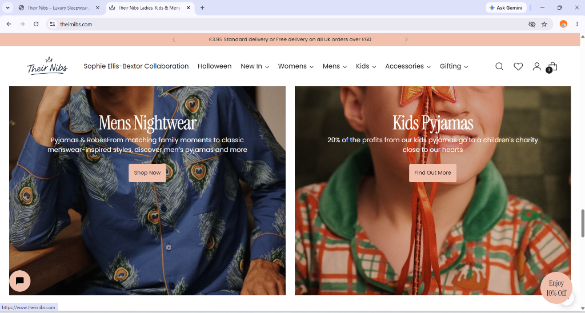
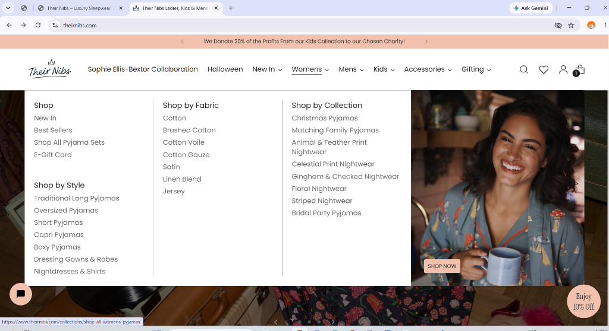
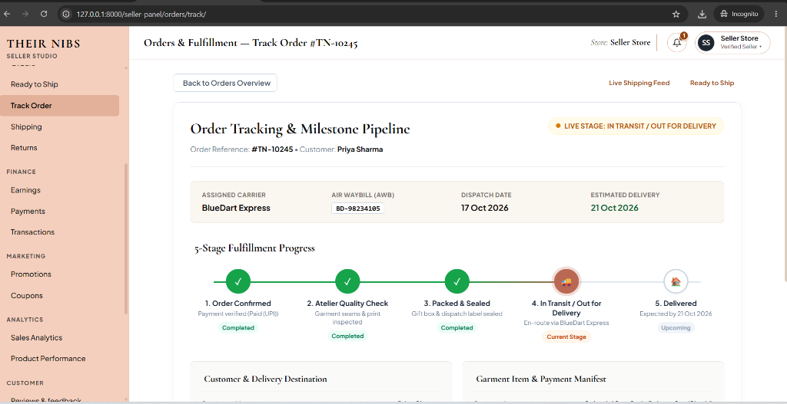
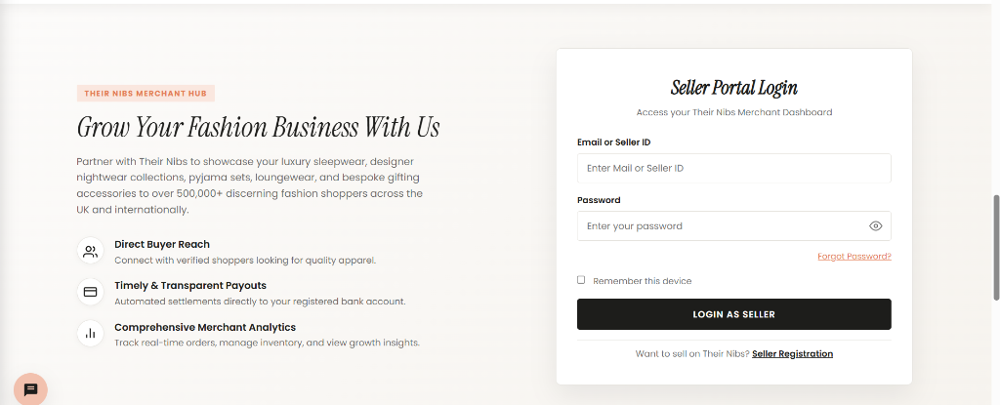
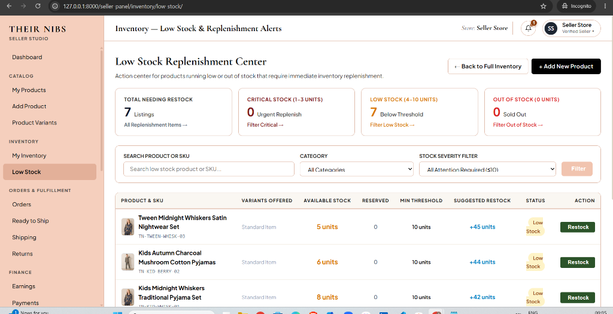
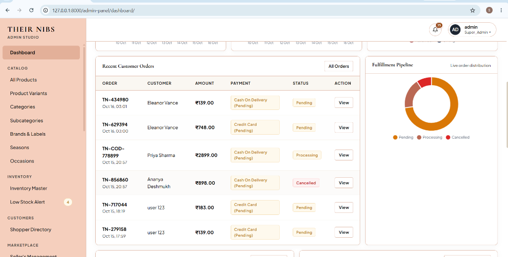
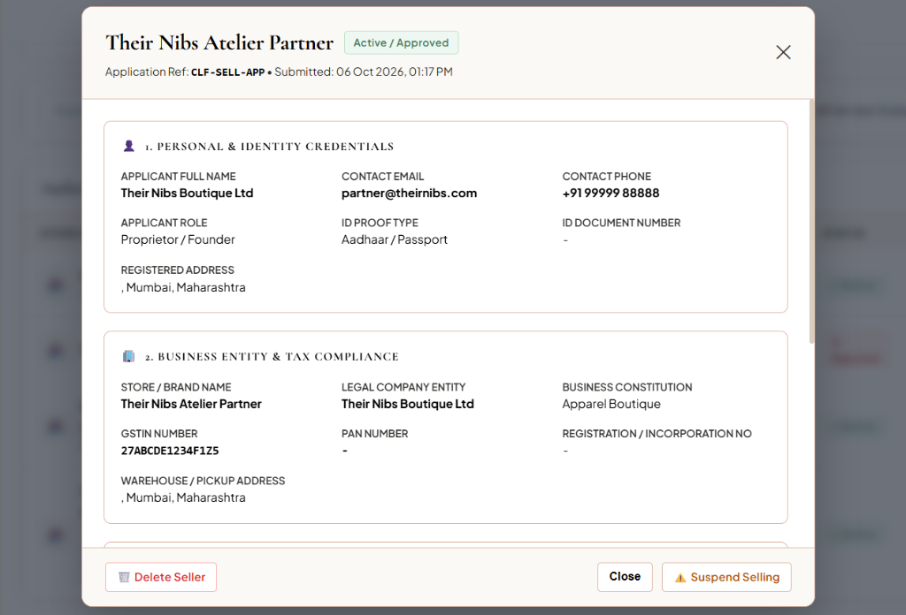

# Their Nibs — Luxury Sleepwear & Loungewear Platform

[](https://www.python.org/)
[](https://www.djangoproject.com/)
[](https://www.sqlite.org/)
[](https://en.wikipedia.org/wiki/HTML5)
[](https://en.wikipedia.org/wiki/CSS)
[](https://developer.mozilla.org/en-US/docs/Web/JavaScript)
[](LICENSE)

> A modern, multi-portal luxury e-commerce platform inspired by British heritage nightwear. Built with Django and designed for seamless multi-channel retail across Customers, Sellers, and Store Administrators.

---

## 🌟 Key Highlights & Modules

### 1. Customer Boutique Storefront
* **Heritage Brand Experience**: Bespoke serif typography, warm terracotta (`#ba6853`) aesthetic, custom preloader, and boutique catalog presentation.
* **Responsive Category Browsing**: Curated collections for **Womens**, **Mens**, **Kids & Tweens**, **Gifting**, **Halloween**, and seasonal drops.
* **Quick Shop / Quick View**: Slide-out modal with dynamic variant/size selection (`XS` to `3XL`), stock alerts, and single-tap cart addition with mobile touch-scroll support.
* **Guest Browsing & Cart Interceptors**: Random visitors can explore all products freely, but adding items to bag or proceeding to checkout securely requires customer authentication.
* **Streamlined Checkout & Payment**:
  * Razorpay payment gateway simulation with adaptive modal sizing.
  * Cash on Delivery (COD) payment option with instant order validation.
  * Downloadable **PDF Tax Invoice** generated on successful order placement via ReportLab.
* **5-Stage Order Tracking**: Real-time status tracker (Placed &rarr; Confirmed &rarr; Dispatched &rarr; In Transit &rarr; Delivered) for customer peace of mind.
* **Customer Account Portal**: Dedicated orders history, saved shipping addresses, profile settings, and persistent interactive wishlist.

### 2. Seller Merchant Hub (`/seller-panel/`)
* **Merchant Dashboard**: Real-time sales metrics, order volumes, revenue summaries, and quick action cards.
* **Inventory Replenishment Center**: Automated low-stock categorization (**Critical Stock (1-3 units)**, **Below Threshold**, and **Out of Stock**) to ensure sellers never miss a restock.
* **Product Catalog Management**: Add, update, and manage nightwear collections with variant sizes, descriptions, and pricing.
* **Orders & Shipping Feed**: Track pending shipments, mark orders as dispatched, and inspect live customer delivery statuses.
* **Mobile Seller Experience**: Slide-out drawer navigation with overlay backdrops for managing shop operations on mobile devices.

### 3. Admin Operations Portal (`/admin-panel/`)
* **Store Governance**: Global oversight of catalog products, categories, active sellers, and customer orders.
* **COD Verification Pipeline**: Review, approve, or reject Cash on Delivery orders with structured rejection logs.
* **Real-Time Notification Feed**: System notifications for new merchant registrations, inventory shortages, and high-value orders.
* **Responsive Control Panel**: Clean desktop and mobile administration interface with collapsible navigation.

---

## 📸 Visual Showcase & Platform Screenshots

### 1. Customer Boutique Storefront
*Immersive British heritage luxury nightwear shopping experience with hand-drawn signature prints and responsive catalog layout.*



---

### 2. Interactive Department Mega Menu
*Deep multi-tier navigation supporting Shop by Style, Fabric, and Curated Occasions with instantaneous hover interactions.*



---

### 3. Real-Time Order Tracking & Milestone Pipeline
*5-stage live fulfillment progress bar with courier synchronization (BlueDart Express AWB) and dispatch milestones.*



---

### 4. Dedicated Merchant & Seller Onboarding Portal
*Secure boutique login and multi-step onboarding workflow for independent nightwear creators and fashion brands.*



---

### 5. Seller Studio — Low Stock Replenishment Center
*Actionable merchant center categorizing critical stock shortages (1–3 units), below-threshold alerts, and one-click replenishment.*



---

### 6. Admin Studio Operations Dashboard
*Central executive command center displaying live revenue metrics, recent orders feed, and real-time fulfillment donut distribution.*



---

### 7. Multi-Vendor KYC Moderation & Seller Governance
*Granular merchant compliance verification examining business entity records, GSTIN/PAN proofs, and one-click store moderation.*




---

## 🏗️ Architecture & Technology Stack

| Component | Technology | Description |
| :--- | :--- | :--- |
| **Backend Framework** | **Django 6.1.1 (Python 3.10+)** | Robust Model-View-Template (MVT) architecture with strict session authentication |
| **Database** | **SQLite (`db.sqlite3`)** | Zero-configuration, portable relational database with 2,800+ seeded luxury products |
| **Frontend** | **HTML5, CSS3 & JavaScript** | High-performance client without heavy front-end framework overhead |
| **PDF Engine** | **ReportLab 5.0+** | Dynamic thermal & A4 invoice generation for confirmed purchases |
| **Security** | **python-dotenv** | Environment-isolated secrets with zero hardcoded API keys |
| **Payment** | **Razorpay** | Secure online payment processing with Razorpay Checkout, payment verification, and transaction handling |
---

## 📁 Project Directory Structure

```text
theirnibs/
├── admin_panel/            # Administrative dashboard, seller approvals & COD verification
│   ├── models.py           # Core schema (Product, Category, Order, Seller, Brand)
│   ├── views.py            # Admin views & analytics handlers
│   └── templates/          # Admin panel HTML templates
├── seller_panel/           # Merchant portal, replenishment center & order tracking
│   ├── views.py            # Inventory management & restock views
│   └── templates/          # Seller panel HTML templates
├── store/                  # Customer storefront, checkout, cart & invoice generation
│   ├── invoice_generator.py# ReportLab PDF invoice generation
│   ├── views.py            # Store, cart, checkout & customer account views
│   └── urls.py             # Customer-facing routing
├── product/                # Product collection views & catalog filters
├── templates/              # Base templates, navigation headers, modals & customer portal
├── static/                 # CSS stylesheets, custom JS modules, brand logos & favicon assets
├── docs/screenshots/       # High-resolution platform screenshots for GitHub
├── db.sqlite3              # Pre-seeded SQLite database with 2,800+ items & demo credentials
├── seed_demo_accounts.py   # One-click seed script for Admin, Seller & Customer accounts
├── .env.example            # Environment configuration template
├── .gitignore              # Production Git ignore rules
├── manage.py               # Django management CLI
├── requirements.txt        # Python package dependencies
└── README.md               # Project documentation
```

---

## 🚀 Quick Start & Setup Guide

### 1. Prerequisites
* **Python 3.10+** installed on your system.
* **Git** installed.

### 2. Clone the Repository
```bash
git clone https://github.com/buildwithsavan/Their-Nibs.git
cd Their-Nibs/theirnibs
```

### 3. Create and Activate a Virtual Environment
```bash
# Windows (PowerShell)
python -m venv venv
.\venv\Scripts\Activate.ps1

# macOS / Linux
python3 -m venv venv
source venv/bin/activate
```

### 4. Install Dependencies
```bash
pip install -r requirements.txt
```

### 5. Configure Environment Variables
Create your local `.env` file from the provided template:
```bash
cp .env.example .env
```
*(Default settings use SQLite, requiring zero database installation or port configuration!)*

### 6. Run Migrations & Start the Development Server
```bash
python manage.py migrate
python manage.py runserver
```

Open your browser and navigate to:
* **Customer Boutique**: [http://127.0.0.1:8000/](http://127.0.0.1:8000/)
* **Seller Portal**: [http://127.0.0.1:8000/seller-panel/](http://127.0.0.1:8000/seller-panel/)
* **Admin Hub**: [http://127.0.0.1:8000/admin-panel/](http://127.0.0.1:8000/admin-panel/)

---

## 🔑 Demo Credentials & Portal Access

The pre-seeded SQLite database comes pre-configured with active accounts across all three platform tiers for immediate evaluation:

| Role / Portal | Portal URL | Username / Email | Password | Permissions & Capabilities |
| :--- | :--- | :--- | :--- | :--- |
| **Store Administrator** | [`/admin-panel/`](http://127.0.0.1:8000/admin-panel/) | `admin` | `admin123` | Full superuser access, platform governance, order dispatch, COD review, and vendor KYC moderation |
| **Verified Merchant / Seller** | [`/seller-panel/`](http://127.0.0.1:8000/seller-panel/) | `seller@gmail.com` | `seller123` | Authorized seller studio, catalog creation, inventory alerts, low-stock replenishment & order management |
| **Customer Shopper** | [`/`](http://127.0.0.1:8000/) or [`/customer/login/`](http://127.0.0.1:8000/customer/login/) | `user@gmail.com` | `user123` | Boutique purchasing, size selector, interactive wishlist, COD/online checkout & 5-stage order tracking |

> **💡 Quick Tip**: If you ever need to reset or re-seed these default credentials on a fresh clone or new database, simply run:
> ```bash
> python seed_demo_accounts.py
> ```

---

## 👥 The Engineering Team & Contributors

This project was built collaboratively by our dedicated team of 4 software engineers:

| Contributor | GitHub Profile |
| :--- | :--- |
| **Savan Bharvadiya** | [@buildwithsavan](https://github.com/buildwithsavan) |
| **Harsh Mordiya** | [@harshmordiya](https://github.com/harshmordiya) |
| **Khushi Parmar** | [@parmarkhushi2026-max](https://github.com/parmarkhushi2026-max) |
| **Aastha Prajapati** | [@prajapatiaastha844-png](https://github.com/prajapatiaastha844-png) |

---

## 📄 License
This project is open-source and available under the [MIT License](LICENSE).
